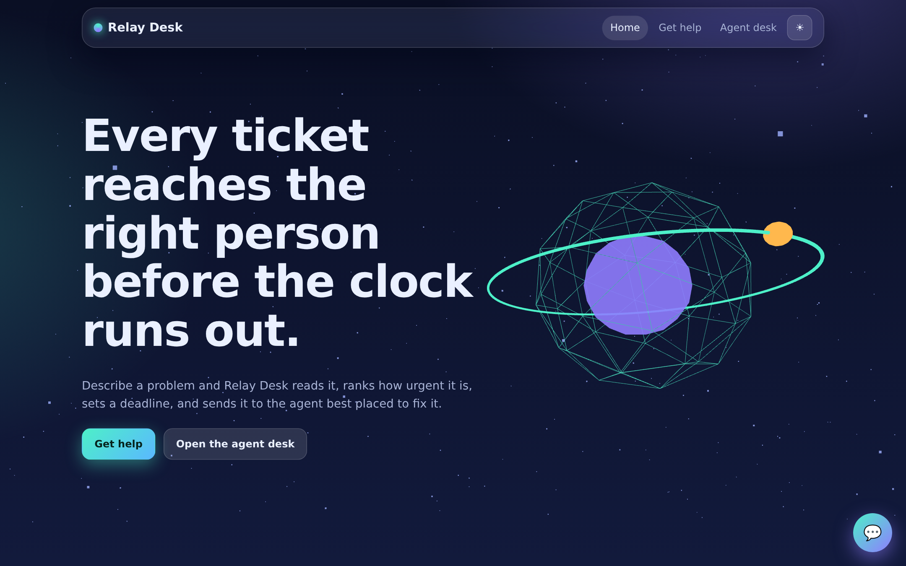
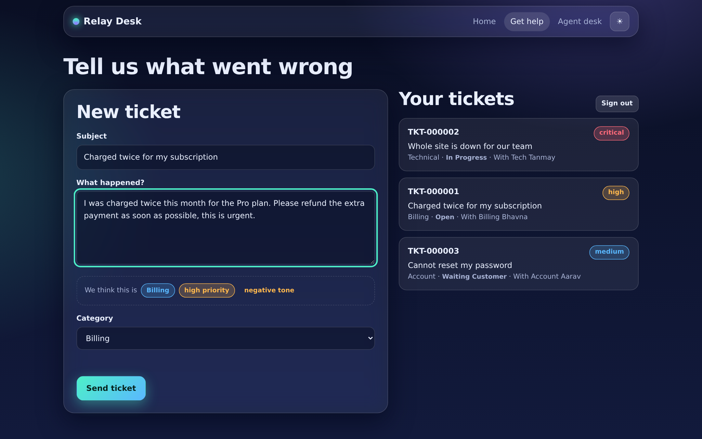
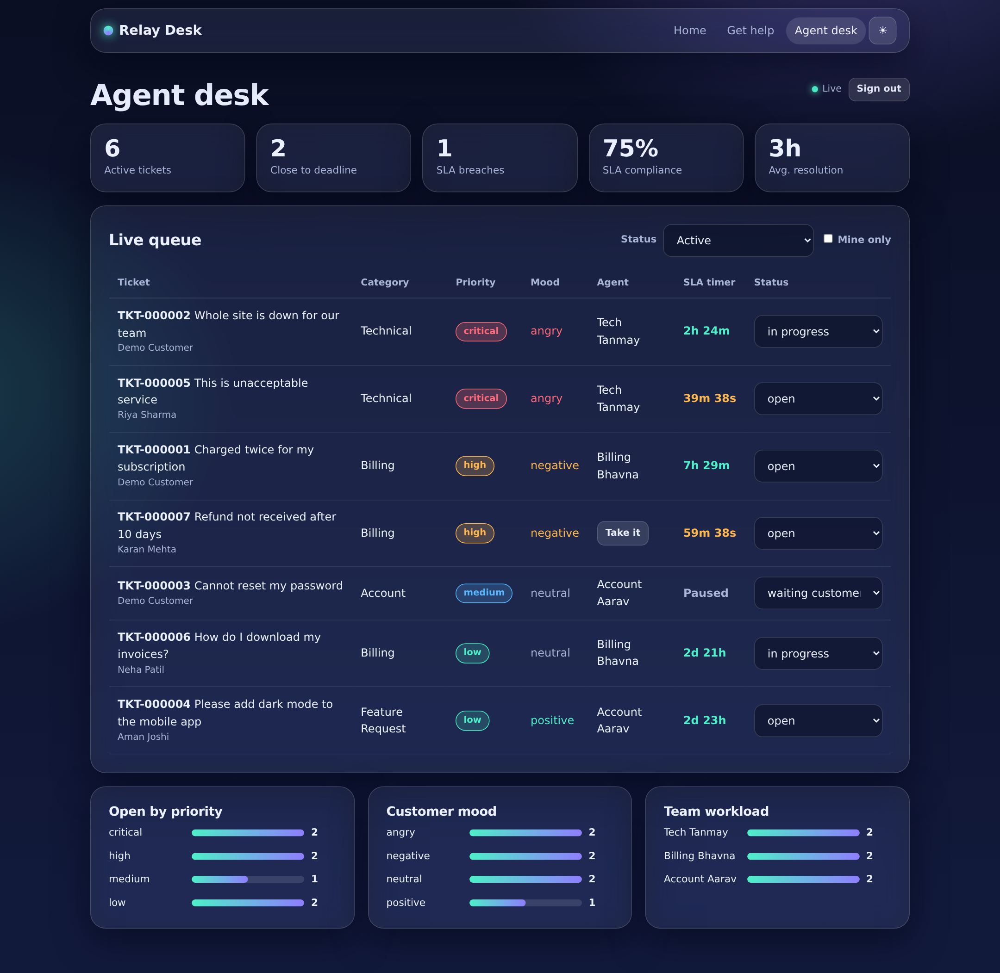
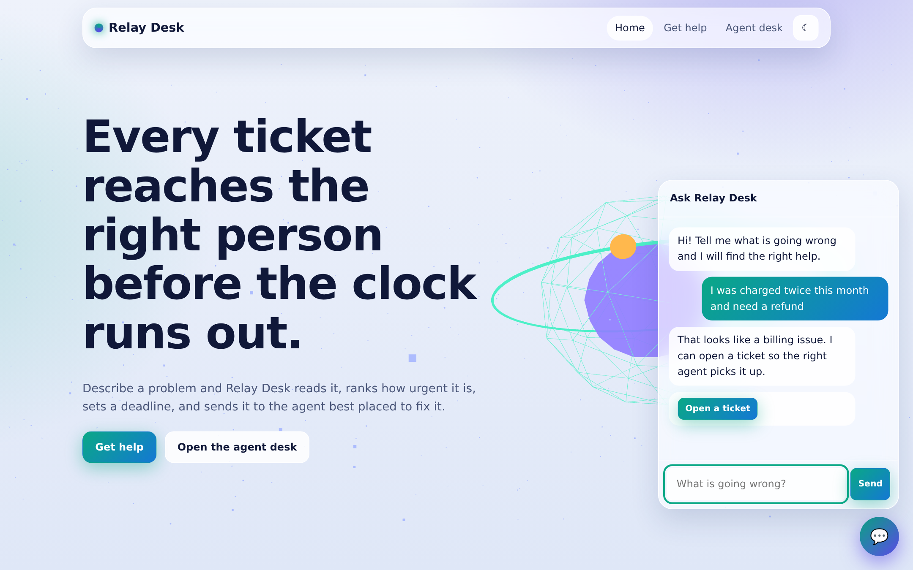
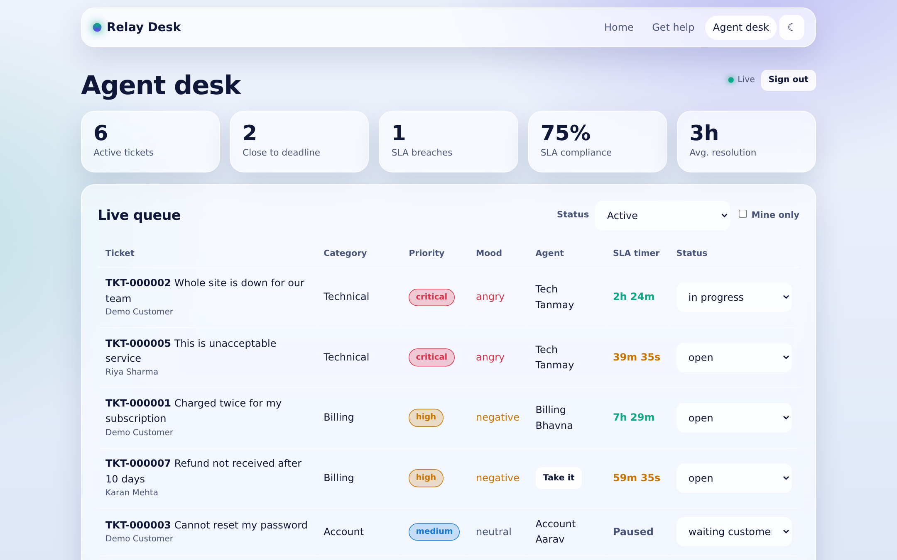
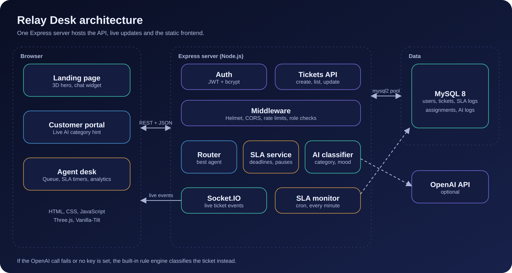
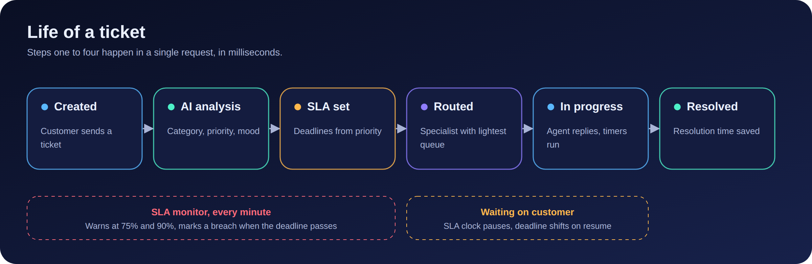
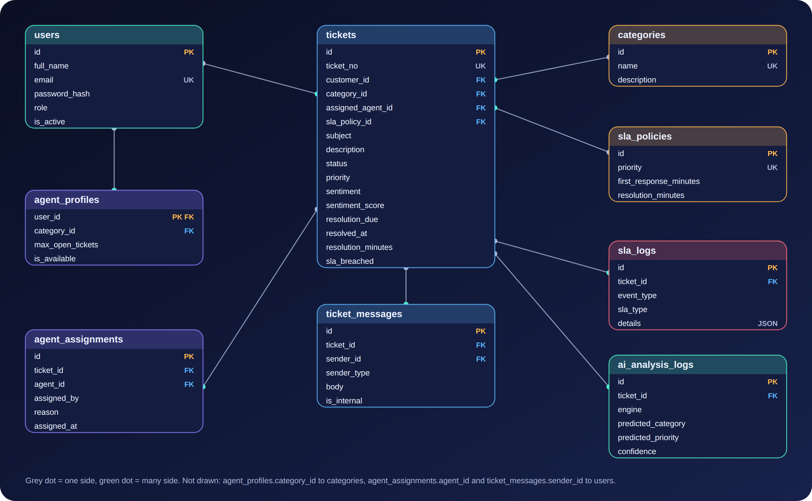

# Relay Desk: AI-Powered Customer Support & Automatic Ticketing System



Express + MySQL backend, Socket.IO live updates, a rule-based AI classifier (with optional OpenAI),
and a glassmorphism UI with a Three.js hero and Vanilla-Tilt cards.

## Screenshots

Captured from the real pages. The agent desk and portal use sample data, since no database was running when these were taken.

| | |
|---|---|
|  |  |
| Customer portal: category and urgency suggested while typing | Agent desk: live queue, SLA countdowns, analytics |
|  |  |
| Light theme and chat widget | Light theme agent desk |

## Diagrams





## Run it in 5 steps

1. Install Node.js 18+ and MySQL 8, then: `npm install`
2. Copy `.env.example` to `.env` and set `DB_PASSWORD` and `JWT_SECRET`
3. Create tables: `npm run db:init`
4. Add demo users and sample tickets: `npm run db:seed`
5. Start: `npm run dev`, then open http://localhost:3000

Demo logins (created by the seed script):

| Role | Email | Password |
|---|---|---|
| Customer | customer@demo.test | Customer@12345 |
| Agent | tanmay@demo.test | Agent@12345 |
| Admin | admin@demo.test | Admin@12345 |

Change or delete these before any real deployment.

## What is where

```
sql/schema.sql            Tables, indexes, foreign keys, SLA + category seed rows
src/services/ai.service.js        Rule-based classifier + optional OpenAI (falls back automatically)
src/services/ticket.service.js    Create -> classify -> SLA -> route; update with resolution time
src/services/routing.service.js   Specialist first, then lowest open-ticket count
src/services/sla.service.js       Due-date math and SLA log events
src/jobs/slaMonitor.js            Every minute: 75% / 90% warnings and breach marking
src/routes/                       auth, ai (suggest + chat), tickets
public/                           index.html (landing, 3D hero, chat), portal.html, dashboard.html
public/js/dashboard.js            Agent queue, live updates, and ticket-level AI assist
scripts/test-ai.js                `npm run test:ai` checks the classifier with no database needed
public/images/                    Logo, favicon, social cover (og-cover.png) and the three diagrams used on the landing page
docs/images/                      PNG copies of the diagrams for slides, README and your portfolio
docs/screenshots/                 Page screenshots used in this README
```

## API

| Method | Path | Who | Purpose |
|---|---|---|---|
| POST | /api/auth/register, /api/auth/login | public | Customer sign-up, sign-in |
| POST | /api/ai/suggest | public (rate limited) | Live category/priority hint |
| POST | /api/ai/chat | public (rate limited) | Chat widget replies |
| POST | /api/tickets | customer | AI analysis + SLA + routing + save |
| GET | /api/tickets/mine | customer | Own tickets |
| GET | /api/tickets/dashboard | agent, admin | SLA metrics, counts by status, workload, live queue |
| GET | /api/tickets | agent, admin | Filtered queue (`status`, `priority`, `mine=1`) |
| POST | /api/tickets/:id/assist | agent (unassigned/self-assigned tickets), admin | Rule-based ticket summary and safe next-action suggestion |
| PUT | /api/tickets/:id | agent, admin | Change status/priority/assignment; sets resolution time |

Socket.IO events (JWT required): `ticket:new`, `ticket:updated`, `sla:breach`.

The agent desk's ticket assist uses built-in rules only; ticket text is not sent to an external AI provider. Its suggestions are advisory and should be reviewed by an agent before action.

## Using OpenAI

Put `OPENAI_API_KEY` in `.env`. Tickets are then classified by the model, and anything that fails
(timeout, bad JSON, no key) falls back to the rule engine. The live typing suggestion always uses the
rule engine so it costs nothing.

## Two to three week schedule

| When | Goal |
|---|---|
| Days 1-2 | Schema, seed data, auth, `POST /api/tickets` working in Postman |
| Days 3-4 | AI classifier tuned on your own sample tickets; routing and SLA math |
| Days 5-6 | `PUT /api/tickets/:id`, dashboard endpoint, SLA monitor job |
| Week 2, first half | Landing page, 3D hero, chat widget, theme toggle |
| Week 2, second half | Customer portal with live suggestion; agent dashboard with countdowns |
| Week 3, first half | Socket.IO polish, empty and error states, mobile layout, accessibility pass |
| Week 3, second half | Security checklist below, deploy, write your case study with screenshots |

## Security checklist

- Strong `JWT_SECRET`; never commit `.env` (already in `.gitignore`)
- Passwords hashed with bcrypt (cost 12); login errors never reveal which field was wrong
- Parameterized SQL everywhere; no string-built queries from user input
- Helmet headers with a tight Content-Security-Policy, rate limits on auth and public AI endpoints
- Role checks on every staff route; agents can only touch their own or unassigned tickets
- HTML-escaped rendering in the frontend (`SD.esc`)
- Before production: HTTPS, a dedicated MySQL user with only the needed privileges, backups,
  remove demo accounts, move JWTs to httpOnly cookies if you add a separate frontend domain

## Deploying to Render

This repository includes a Render Blueprint (`render.yaml`) for the Express web service. Connect the
GitHub repository to Render and create a Blueprint; Render will install dependencies with `npm ci`,
start the app with `npm start`, check `/api/health`, and deploy new commits automatically.

The app requires an external MySQL 8 database; Render Blueprints provision Render Postgres, which is
not compatible with this MySQL schema. Before the first deploy:

1. Provision a MySQL 8 database with a database/user for this app. Use a provider that permits
   inbound connections from Render and provides TLS.
2. Create the Blueprint and enter the database host, username, password, and database name when
   prompted. `JWT_SECRET` is generated automatically. The Blueprint enables verified TLS for MySQL;
   set `DB_SSL` to `false` only if your database provider does not support TLS.
3. Initialize the database once using credentials with permission to create the `support_desk`
   database: configure the same database values in `.env`, then run `npm run db:init`. Do not run
   `npm run db:seed` in production; it creates publicly known demo accounts.
4. Confirm the service reports healthy at `/api/health`. Keep the app and database in regions with
   low network latency.

The SLA monitor runs inside the web process every minute. Render's free web services can spin down
while idle, so use an always-on plan if SLA monitoring must continue uninterrupted. The app serves
the frontend and API from one origin, so `CORS_ORIGIN` can remain unset.

To publish the source, push this project to a GitHub repository and connect that repository to Render.
Never commit `.env` or production credentials.

## Using the images

- The favicon and social preview image are already linked in every page's `<head>`. After you deploy, change the `og:image` value in `public/index.html` to the full URL (for example `https://yourdomain.com/images/og-cover.png`) so link previews work on LinkedIn and WhatsApp.
- The three diagrams also appear on the landing page under "How it fits together".
- Screenshots use a fallback font because Google Fonts could not load when they were taken; your running copy will use Bricolage Grotesque and Instrument Sans.

## Known limits (good next steps)

- No ticket detail page or agent replies yet; the `ticket_messages` table is ready for it
- Password reset emails, admin user management and email notifications are not built
- The category list in the portal comes from the database; routing specialties are set in `agent_profiles`
- This project was smoke-tested for server start, static pages, the AI endpoints and auth guards; the MySQL
  code paths need your first real run (`npm run db:init` and `db:seed`) to confirm on your setup
